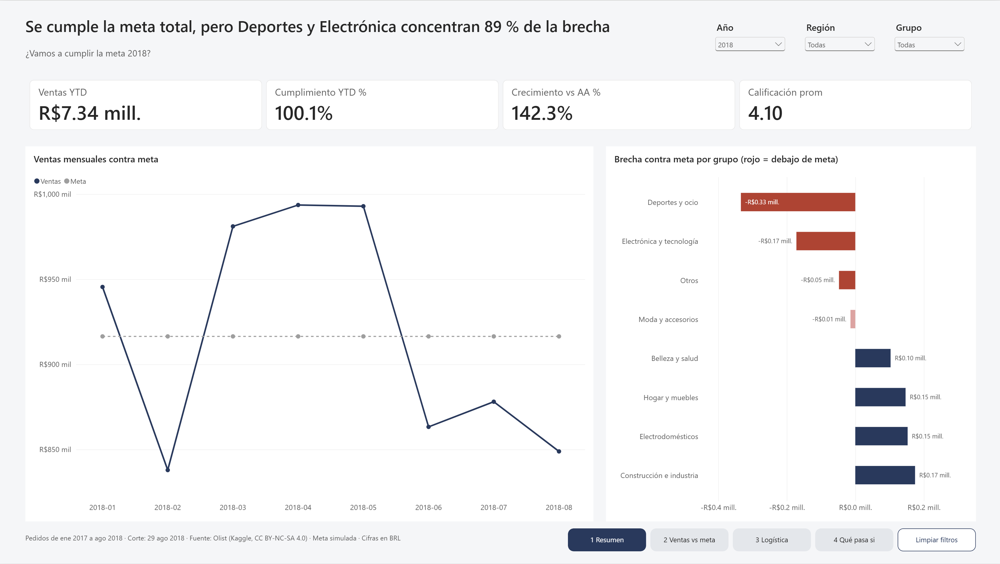
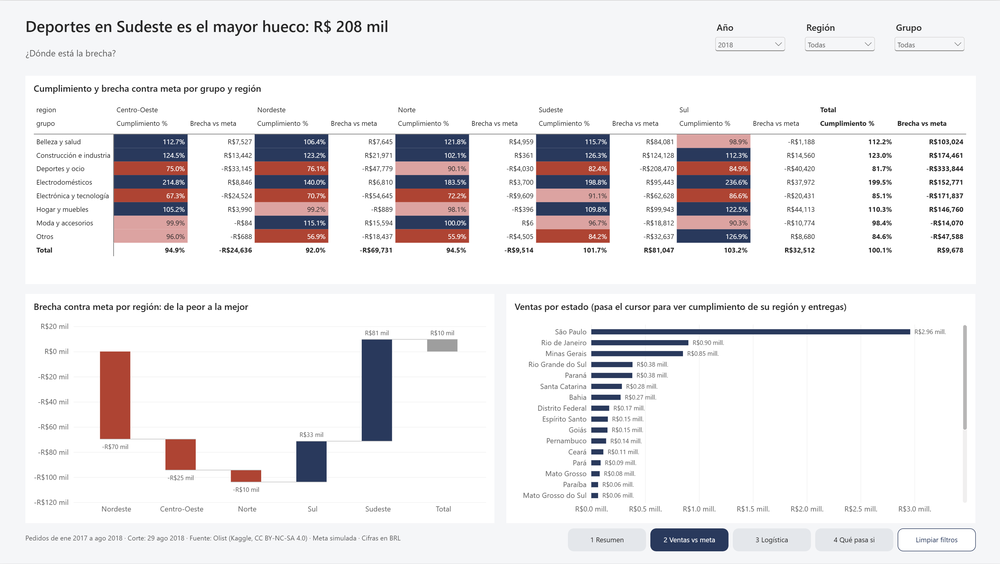
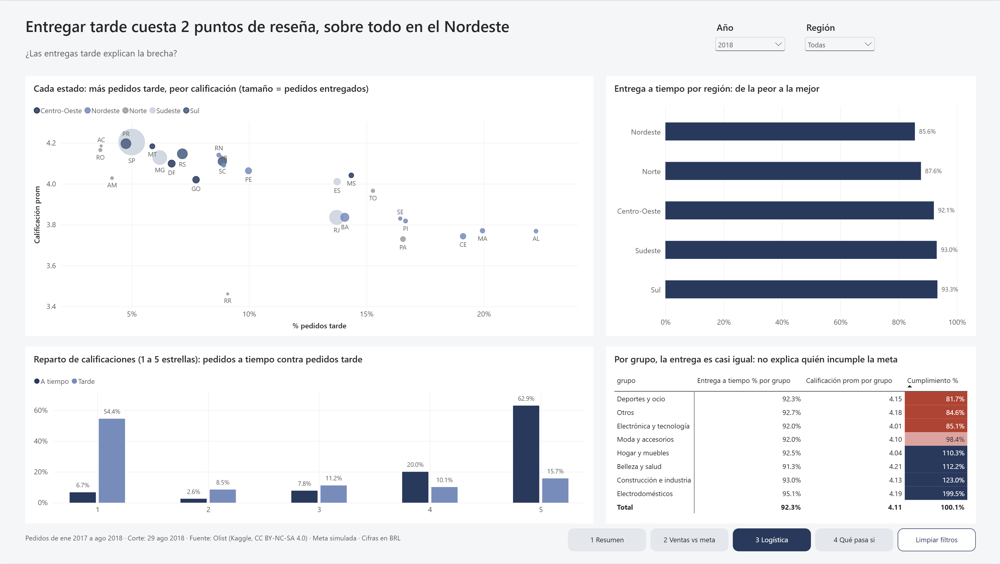
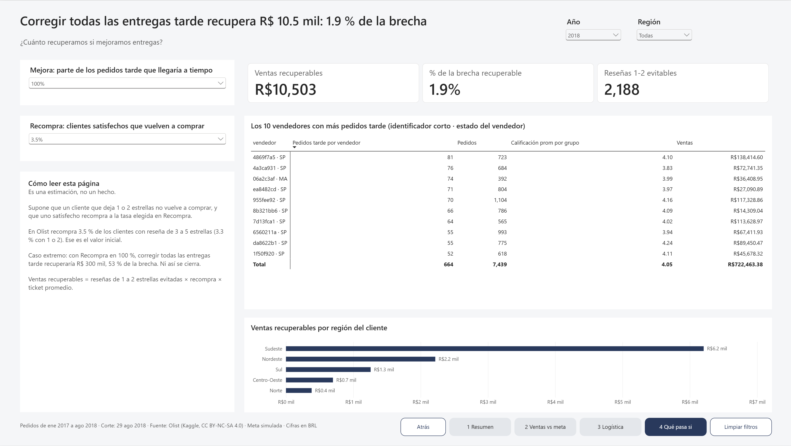

# Sales vs target · Olist 2018

A Power BI dashboard over ~100k real e-commerce orders, fed from PostgreSQL and an Excel targets workbook.

[Versión en español](README.md)

**Finding:** the gap against target sits in Sports and Electronics; late deliveries cut review scores by two points but explain less than 2% of the shortfall.



The dashboard itself is in Spanish.

## The question

Which categories and regions are below target in 2018, and how much of that gap is explained by late deliveries dragging reviews down?

It is a sales manager's decision: where to put the effort to close the gap.

## Result in three figures (Jan–Aug 2018)

| Figure | Value |
| --- | --- |
| Target attainment | 100.1% (R$ 7.34M against R$ 7.33M) |
| Gap of the groups below target | R$ 567k; Sports and Electronics account for 89% |
| Review score, late orders against on-time orders | 2.06 points lower |

## What I found

- **The overall target is met, but not everywhere.** Sports and leisure reaches 81.7% and Electronics and technology 85.1%; the largest single shortfall is Sports in the Southeast region, at R$ 208k.
- **Late delivery sinks the review.** 63% of late orders get 1 or 2 stars, against 9% of on-time orders.
- **But it barely moves sales.** On Olist, 3.5% of customers buy again, whether their review was good or bad. Fixing every late delivery would recover about R$ 10.5k, 1.9% of the gap. Even assuming every satisfied customer buys again, the gap does not close (53%).
- **By region there is a link.** The Northeast has the worst on-time delivery (85.6% in 2018) and the worst attainment (92.0%).

The starting hypothesis was that logistics explained the gap. The data rejects it.

## Recommendation

Work on assortment and pricing in Sports and Electronics to close the gap, and treat Northeast logistics as a customer-satisfaction problem, not a sales problem.

## The dashboard

| Page | Question it answers |
| --- | --- |
| 1. Summary | Will we hit the 2018 target? |
| 2. Sales vs target | Where is the gap? |
| 3. Logistics and reviews | Do late deliveries explain the gap? |
| 4. What if | How much do we recover by improving deliveries? |







## How I built it

```
9 Olist CSVs ──> PostgreSQL (Docker) ──> 7 views ──> Power BI
                      │                                ▲
                      └── 2017 sales ──> Excel targets ─┘
```

- **SQL (PostgreSQL 18).** Load, cleaning and seven views across three schemas (`raw`, `stg`, `bi`), with CTEs and window functions; for example, to keep the most recent review of each order.
- **Excel.** `Metas_2018.xlsx` computes the target by month, group and region with `AVERAGEIFS` and `XLOOKUP` over named cells. All assumptions live on one sheet.
- **Power Query.** Reads the views and unpivots the targets sheet (months as columns) into long format.
- **Model.** A star schema with three fact tables at different grains (order items, orders and targets) and six dimensions. Every relationship is one-to-many and single-direction.
- **DAX.** 38 measures with descriptions, organised in folders: time intelligence, attainment against target, logistics and what-if analysis.

### Three modelling decisions

1. **Two sales fact tables.** Price lives at order-item level; delivery and review at order level. Mixing them duplicates reviews. When an order-level measure has to be filtered by product group, it is solved in DAX with `TREATAS`, not with a bidirectional relationship.
2. **An honest year-over-year comparison.** The data ends in August 2018. A calendar column flags the days that have sales, so `SAMEPERIODLASTYEAR` compares eight months against eight months and not against all of 2017.
3. **DAX blanks count as zero.** A `dias_retraso <= 0` filter includes orders with no delivery date. The logistics measures use a text column (`A tiempo` / `Tarde`) that stays blank when there is no delivery.

Every measure was checked against a query in `sql/04_validacion.sql`. Total sales match to the cent: R$ 13,449,529.68.

## How to reproduce

1. Download the [Brazilian E-Commerce dataset by Olist](https://www.kaggle.com/datasets/olistbr/brazilian-ecommerce) and unzip the 9 CSVs into `data/`.
2. Copy `.env.example` to `.env` and set your user and password.
3. Start the database. The first run executes `sql/01` to `sql/04` in order:

   ```bash
   docker compose up -d
   ```

4. Open `ventas_vs_meta.pbip` in Power BI Desktop and refresh. The model connects to `localhost:5433`, database `olist`, and reads the Excel file from the `RutaExcel` parameter: point it to your copy.

## Structure

```
├── docker-compose.yml
├── sql/                          # 01 load · 02 cleaning · 03 views · 04 validation
├── data/mapeos/                  # categories → groups, states → regions
├── excel/Metas_2018.xlsx
├── ventas_vs_meta.pbip           # Power BI project
├── ventas_vs_meta.Report/        # pages and visuals (PBIR format)
├── ventas_vs_meta.SemanticModel/ # model and measures (TMDL format)
├── docs/medidas.md               # every measure with its formula and description (Spanish)
└── img/                          # screenshots
```

## Assumptions and limits

- **The target is simulated.** It is the Sep–Dec 2017 monthly average by group and region, times a growth factor (1.20 overall, 1.30 for Beauty and health). It does not use the same month of 2017 because Jan–Aug sales grew 2.4 times year over year, which would put attainment at ~207%. That is why the target is flat from January to August.
- **Period.** Orders purchased from Jan 2017 to Aug 2018; 2016 and Sep–Oct 2018 have very few orders.
- **What counts as a sale.** An item of an order that is neither canceled nor `unavailable`, excluding freight, dated at purchase.
- **Recoverable sales is an estimate.** It assumes a customer who leaves 1 or 2 stars does not buy again, and that a satisfied one buys again at the observed rate.
- **Currency.** Brazilian reais (BRL).

## Data and license

[Brazilian E-Commerce Public Dataset by Olist](https://www.kaggle.com/datasets/olistbr/brazilian-ecommerce), CC BY-NC-SA 4.0. The CSVs are not included in the repository.
