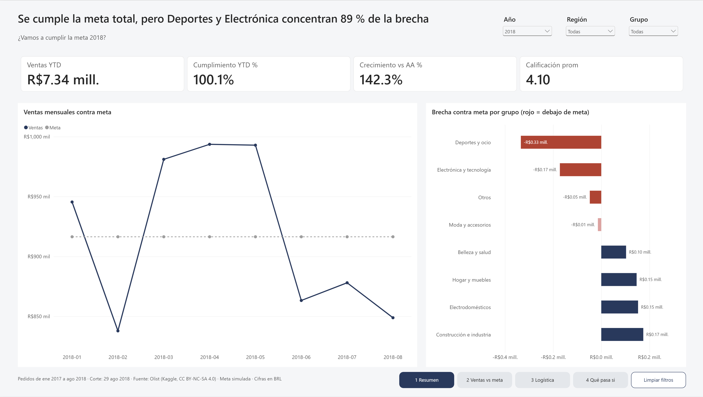
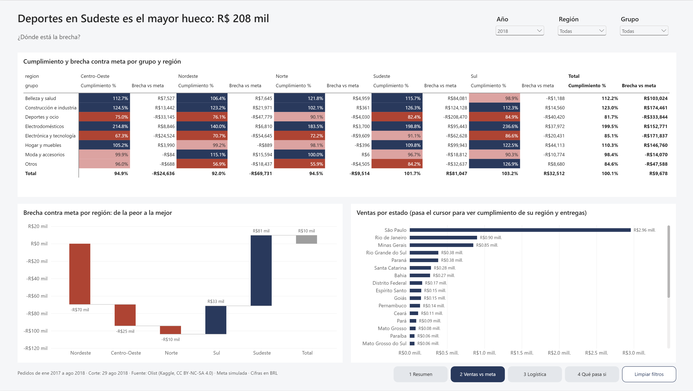
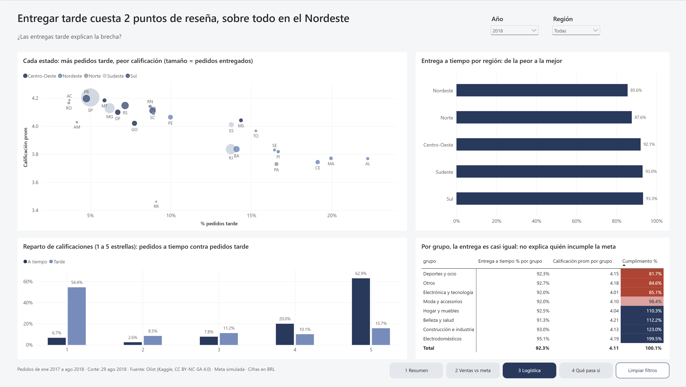
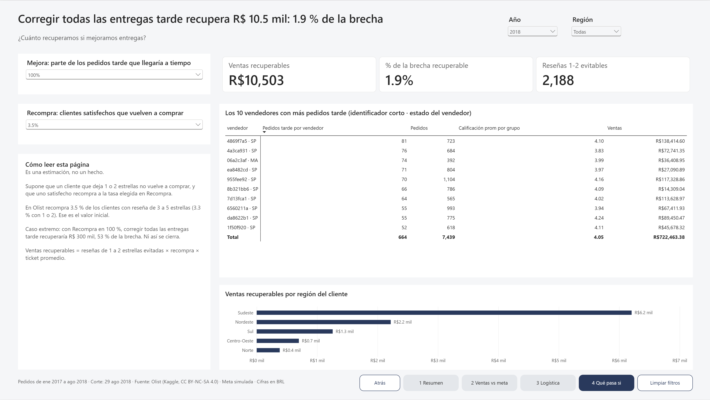

# Ventas vs meta · Olist 2018

Tablero en Power BI sobre ~100 mil pedidos reales de e-commerce, alimentado desde PostgreSQL y un Excel de metas.

[English version](README.en.md)

**Hallazgo:** la brecha contra meta está en Deportes y Electrónica; las entregas tarde bajan dos puntos la reseña pero explican menos de 2 % del hueco.



## La pregunta

¿Qué categorías y regiones van por debajo de la meta en 2018, y cuánto de ese hueco se explica por entregas tardías que bajan las reseñas?

Es la decisión de un gerente comercial: dónde poner el esfuerzo para cerrar la brecha.

## Resultado en tres cifras (ene–ago 2018)

| Cifra | Valor |
| --- | --- |
| Cumplimiento de la meta | 100.1 % (R$ 7.34 M contra R$ 7.33 M) |
| Brecha de los grupos debajo de meta | R$ 567 mil; Deportes y Electrónica explican 89 % |
| Calificación de pedidos tarde contra pedidos a tiempo | 2.06 puntos menos |

## Qué encontré

- **La meta total se cumple, pero no en todos lados.** Deportes y ocio queda en 81.7 % y Electrónica y tecnología en 85.1 %; el mayor hueco individual es Deportes en la región Sudeste, con R$ 208 mil.
- **Entregar tarde hunde la reseña.** 63 % de los pedidos tarde recibe 1 o 2 estrellas, contra 9 % de los que llegan a tiempo.
- **Pero casi no mueve las ventas.** En Olist recompra 3.5 % de los clientes, tengan buena o mala reseña. Corregir todas las entregas tarde recuperaría unos R$ 10.5 mil, 1.9 % de la brecha. Ni suponiendo que todos los clientes satisfechos recompran se cierra el hueco (53 %).
- **Por región sí hay relación.** Nordeste tiene la peor entrega a tiempo (85.6 % en 2018) y el peor cumplimiento (92.0 %).

La hipótesis inicial era que la logística explicaba la brecha. Los datos la rechazan.

## Recomendación

Atacar el surtido y el precio de Deportes y Electrónica para cerrar la brecha, y tratar la logística del Nordeste como un problema de satisfacción del cliente, no de ventas.

## El tablero

| Página | Pregunta que responde |
| --- | --- |
| 1. Resumen | ¿Vamos a cumplir la meta 2018? |
| 2. Ventas vs meta | ¿Dónde está la brecha? |
| 3. Logística y reseñas | ¿Las entregas tarde explican la brecha? |
| 4. Qué pasa si | ¿Cuánto recuperamos si mejoramos entregas? |







## Cómo lo construí

```
9 CSV de Olist ──> PostgreSQL (Docker) ──> 7 vistas ──> Power BI
                        │                                  ▲
                        └── ventas 2017 ──> Excel de metas ─┘
```

- **SQL (PostgreSQL 18).** Carga, limpieza y siete vistas en tres esquemas (`raw`, `stg`, `bi`), con CTE y funciones de ventana; por ejemplo, para quedarse con la reseña más reciente de cada pedido.
- **Excel.** `Metas_2018.xlsx` calcula la meta por mes, grupo y región con `AVERAGEIFS` y `XLOOKUP` sobre celdas con nombre. Los supuestos viven en una sola hoja.
- **Power Query.** Lee las vistas y despivota la hoja de metas (meses como columnas) a formato largo.
- **Modelo.** Estrella con tres tablas de hechos de distinta granularidad (partidas, pedidos y metas) y seis dimensiones. Todas las relaciones son de uno a varios y de dirección única.
- **DAX.** 38 medidas con descripción, organizadas en carpetas: inteligencia de tiempo, cumplimiento contra meta, logística y análisis qué pasa si.

### Tres decisiones de modelado

1. **Dos hechos de ventas.** El precio vive por partida; la entrega y la reseña, por pedido. Mezclarlos duplica reseñas. Cuando una medida de pedidos debe filtrarse por grupo de producto, se resuelve en DAX con `TREATAS`, no con una relación bidireccional.
2. **Comparar contra el año anterior sin trampa.** Los datos terminan en agosto de 2018. Una columna del calendario marca los días con ventas para que `SAMEPERIODLASTYEAR` compare ocho meses contra ocho meses y no contra todo 2017.
3. **Los blancos de DAX cuentan como cero.** Un filtro `dias_retraso <= 0` incluye los pedidos sin fecha de entrega. Las medidas de logística usan una columna de texto (`A tiempo` / `Tarde`) que queda en blanco cuando no hay entrega.

Cada medida se verificó contra una consulta de `sql/04_validacion.sql`. Las ventas totales coinciden al centavo: R$ 13,449,529.68.

## Cómo reproducir

1. Descarga el dataset [Brazilian E-Commerce de Olist](https://www.kaggle.com/datasets/olistbr/brazilian-ecommerce) y descomprime los 9 CSV en `data/`.
2. Copia `.env.example` a `.env` y pon tu usuario y contraseña.
3. Levanta la base. La primera vez ejecuta `sql/01` a `sql/04` en orden:

   ```bash
   docker compose up -d
   ```

4. Abre `ventas_vs_meta.pbip` en Power BI Desktop y actualiza los datos. El modelo se conecta a `localhost:5433`, base `olist`, y lee el Excel desde el parámetro `RutaExcel`: cámbialo a la ruta de tu copia.

## Estructura

```
├── docker-compose.yml
├── sql/                          # 01 carga · 02 limpieza · 03 vistas · 04 validación
├── data/mapeos/                  # categorías → grupos, estados → regiones
├── excel/Metas_2018.xlsx
├── ventas_vs_meta.pbip           # proyecto de Power BI
├── ventas_vs_meta.Report/        # páginas y visuales (formato PBIR)
├── ventas_vs_meta.SemanticModel/ # modelo y medidas (formato TMDL)
├── docs/medidas.md               # cada medida con su fórmula y descripción
└── img/                          # capturas
```

## Supuestos y límites

- **La meta es simulada.** Es el promedio mensual de sep–dic 2017 por grupo y región, por un factor de crecimiento (1.20 general, 1.30 para Belleza y salud). No usa el mismo mes de 2017 porque las ventas de ene–ago crecieron 2.4 veces de un año a otro y la meta quedaría en ~207 % de cumplimiento. Por eso la meta es plana de enero a agosto.
- **Periodo.** Pedidos comprados de ene 2017 a ago 2018; 2016 y sep–oct 2018 tienen muy pocos pedidos.
- **Qué es una venta.** Partida de un pedido que no está cancelado ni `unavailable`, sin flete, con la fecha de compra.
- **Ventas recuperables es una estimación.** Supone que un cliente con 1 o 2 estrellas no recompra y que uno satisfecho recompra a la tasa observada.
- **Moneda.** Reales brasileños (BRL).

## Datos y licencia

[Brazilian E-Commerce Public Dataset by Olist](https://www.kaggle.com/datasets/olistbr/brazilian-ecommerce), licencia CC BY-NC-SA 4.0. Los CSV no se incluyen en el repositorio.
